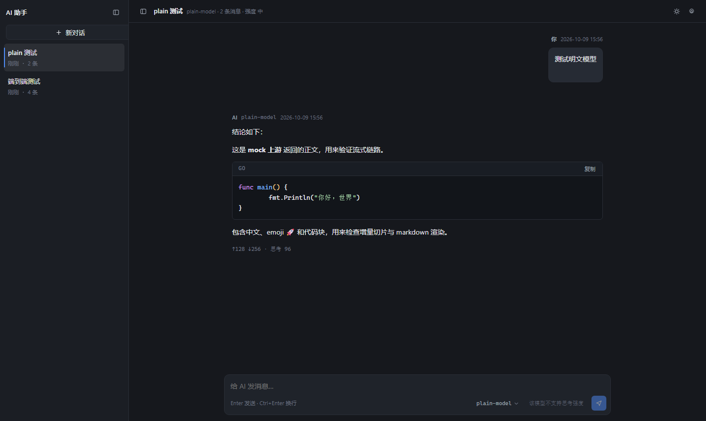
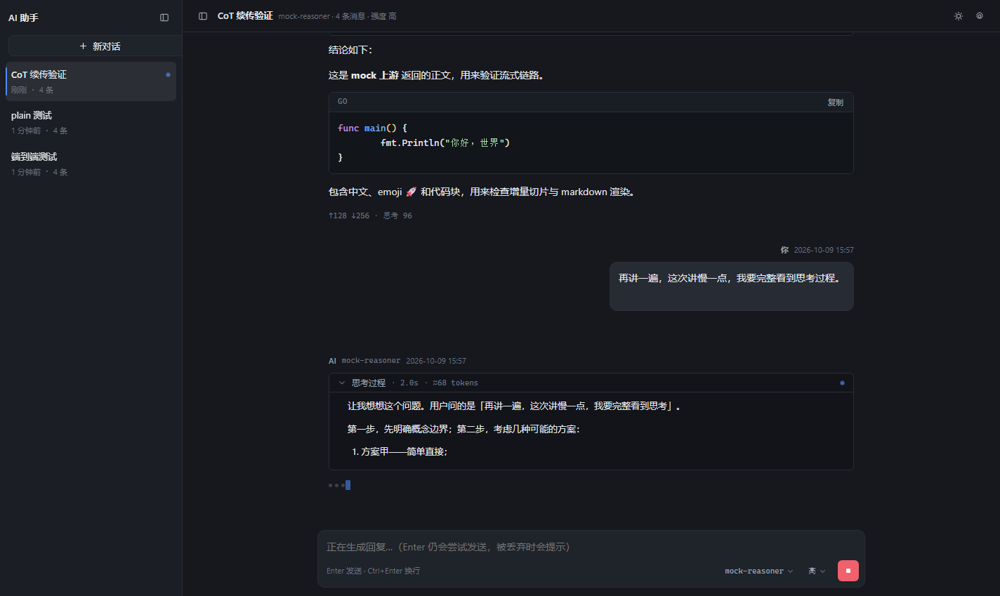
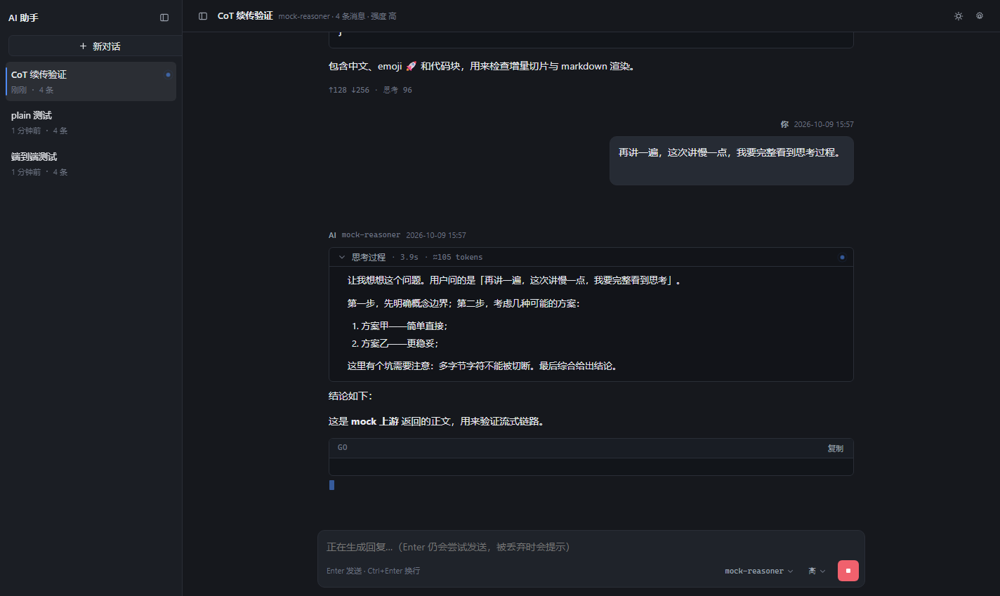
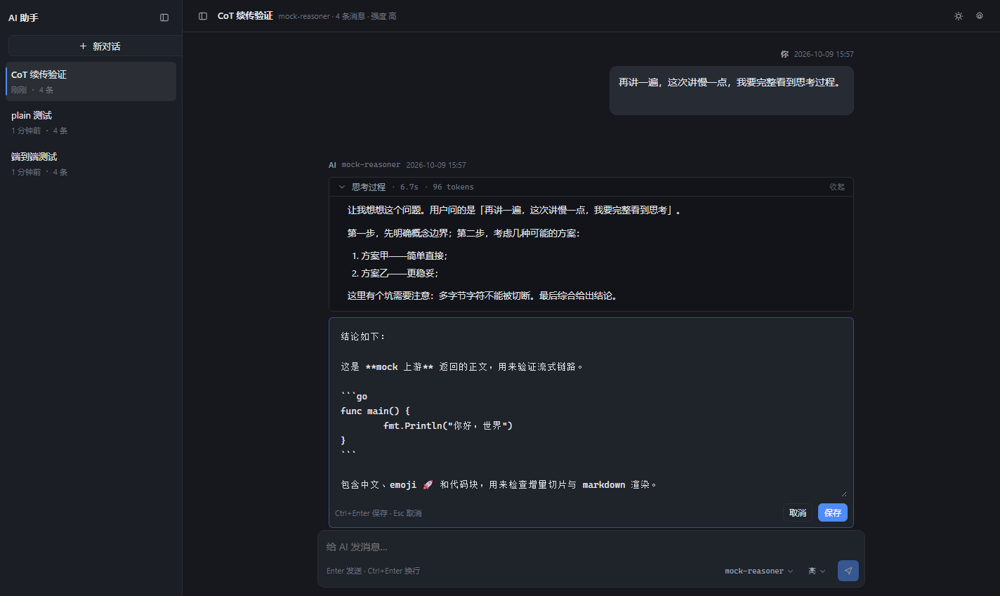

# Akatosh

> 在《上古卷轴》中，Akatosh 是九圣灵之首与时间龙神：时间的流逝、开端与终结都在他的权柄之内；
> 在《湮灭》的结局中，他的化身降临帝都，将梅鲁涅斯·大衮逐回湮灭。这个项目借用这个意象——
> 对话历史可以回放、改写和分叉，像是在不同时间线之间制造一次小小的“龙破”。

Akatosh 是一个以“时间线”为核心的本地多用户 LLM Agent：它把每一次对话都视为可回放、
可编辑、可分叉的历史——CoT、正文、工具调用与上下文压缩都会完整落库；你可以修改某个节点、
从任意消息 fork 出新分支，让不同的推理路径并行演化。联网搜索、Python 沙箱、文档读取和图像
生成以 function calling 接入，所有数据默认保存在本机 SQLite 与附件目录中，适合自己掌控数据、
上下文和成本的长期使用。

Go 后端 + Vue 3 前端，前端产物嵌入单个可执行文件，只监听本机 `127.0.0.1:28888`，
数据存在本地 SQLite 里。


- 左侧对话历史，右侧对话内容；长会话**向上滚动分页加载**更早的消息，首屏只取最近若干条
- **联网搜索（function calling）**：会话级开关，开启后模型可在生成中自主调用 `web_search`
  搜索网页（所有工具共用最多 8 轮熔断），搜索过程实时可见、来源链接随消息保存；搜索后端用自托管
  SearXNG，零 API 成本
- **Python 代码执行（function calling）**：配了沙箱后端（`-pybox`）就全局可用，模型自主
  调用 `run_python` 跑代码（计算/数据处理/验证），代码与输出随消息保存可展开查看。
  沙箱是独立容器，断网 / 只读 / 资源限额由你的部署方式保证（镜像只有 `Dockerfile.pybox`，
  隔离配置见下文「Python 代码执行（可选）」）
- **图像生成（function calling）**：配了 `-imagegen` 就全局可用，模型自主调用 `generate_image`
  画图，生成的图落进附件库、随消息展示（也能贴图追问）
- **文档上传**：回形针可以选 PDF / DOCX / XLSX / 文本 / 代码等文件（单文件 20 MB），
  模型通过 `read_file` 在沙箱里提取内容后讨论；需要 `-pybox`
- **手动上下文压缩**：会话窗口右上角的按钮把较早的历史压成摘要（保留最近 10 条不动），
  被压掉的消息冻结为只读；会话自己的 system prompt 永远不参与压缩。`-compact-threshold`
  控制提示时机，压缩永远手动触发
- **会话级 / 全局默认系统提示词**：每个会话可以单独设；设置里的全局默认是注入式——
  修改后对所有会话的下一轮生效（不是只影响新会话）
- **会话 fork**：从任意一条消息复制整个会话开新分支，原会话不动
- **可装成 PWA**：manifest + Service Worker + 图标齐备，HTTPS 部署下 Android Chrome
  「添加到主屏幕」即成独立应用（无地址栏、离线可开壳）
- **回答完毕的会话会自动冒到列表最上面，并挂一个未读小红点**（点开就熄灭，刷新也不会诈尸）
- **可以配任意多个供应商**，每个会话绑定其中一个；模型选择器按供应商分组
- **支持贴图**（Ctrl+V / 拖拽 / 选文件），列表只加载缩略图、点开才看大图
- 设置里点「获取模型列表」自动拉取模型，不用手写 model id
- 输入框右下角切换**模型**和**思考强度**
- `Enter` 发送，`Ctrl+Enter` / `Shift+Enter` 换行（中文输入法选词时不会误发）
- **完整 CoT 流式刷新显示**，刷新页面不丢、可续传；CoT 也能**编辑 / 还原**
- LLM 回复正文和用户消息都可以**编辑**（保留原文，可一键还原），也能「从这里重新生成」
- 对话标题：先秒出一个兜底名，再由模型异步起一个更好的；**你随时可以自己改**
- 控制台每次请求都打一行用量日志：供应商、思考强度、耗时、token 分布、**前缀缓存命中率**

## 控制台日志长什么样

（节选，字段以代码为准）

```
[gen]   会话 1 发起  供应商=deepseek(1)  model=deepseek-flash  思考强度=high  工具=2 个  历史=5 条
[gen]   会话 1 完成  status=done  供应商=deepseek(1)  model=deepseek-flash  思考强度=high  用时=11.6s  工具=0 轮
        tokens: prompt=17617 completion=2769(思考 632) total=20386
        缓存: 命中=6272 未命中=11345  (前缀缓存命中率 36%)
[title] 会话 1 起标题  model=deepseek-flash  思考强度=none(显式关闭)  用时=0.5s
        tokens: prompt=361 completion=5(思考 0)
[title] 会话 1 标题已生成: "Go 并发模型详解"
```

- `思考强度` 打的是**实际下发**的值；`默认(不下发)` 表示这个模型不需要/不支持这个参数。
  发起行还会带 `供应商` 和声明的 `工具` 个数，完成行带实际 `工具` 轮数（中间每轮
  搜索 / 执行 / 画图也各有一行日志）。
- 缓存命中部分通常便宜一个数量级，所以命中率单独算出来 —— 一眼能看出这次是不是白花钱了。
  上游两种写法（DeepSeek 的 `prompt_cache_hit_tokens`、OpenAI 的 `prompt_tokens_details.cached_tokens`）都会认。
  提醒：缓存有最小粒度（DeepSeek 是 64 token），前缀太短时命中率天然是 0，这是正常的。
- 同样的用量也落库，消息底部会显示 `↑输入 ↓输出 · 思考 N · 缓存 X%`。

## 界面

| 首次进入（自动弹出设置） | 生成中：CoT 逐字刷新 |
|---|---|
|  |  |

| 生成中刷新页面：CoT 接着往下走 | 编辑回复正文 |
|---|---|
|  |  |

上面两张生成中的图是同一次生成：刷新前 CoT 是 `2.0s / ≈59 tokens`，刷新后接着变成 `4.0s / ≈105 tokens`——
**不是从头开始，是续上的**。

---

## 快速开始

仓库里没有构建脚本，就三条命令：前端产物（`web/dist`）被 git 忽略、由 Go 的 `//go:embed`
嵌进二进制，所以**新克隆必须先构建前端，否则 `go build` 会报嵌入目录不存在**。

```powershell
cd web
npm ci
npm run build
cd ..
go build -o ai-assistant.exe .
.\ai-assistant.exe       # 启动后访问 http://127.0.0.1:28888
```

首次启动打开页面会自动弹出设置窗口：

1. 点 **添加供应商**，填一个 OpenAI 兼容的 base url：
   - DeepSeek：`https://api.deepseek.com`
   - 硅基流动：`https://api.siliconflow.cn/v1`
   - Ollama：`http://localhost:11434/v1`
   - 自建 one-api / vLLM：`http://<host>:<port>/v1`

   结尾带不带 `/v1` 都行，粘成完整端点（`.../chat/completions`）也能自动纠正，设置页会显示归一化后的地址。
2. 填 **API Key**（留空表示不需要 key）。保存后想改别的地方时，key 留空 = 不修改现有 key。
3. 点这一行的 **测试连接** 确认通，再点 **获取模型列表** 把模型拉进本地。
4. 关掉设置窗口，新建对话开始聊。

**可以加任意多个供应商**（DeepSeek + 官方 OpenAI + 本地 Ollama 同时配都行）。每个会话绑定其中一个，
输入框右下角的模型下拉**按供应商分组**——两个网关都有 `gpt-4o` 时它们是两条独立选项，各自记住能力
（是否支持思考强度是按「这家供应商的这个模型」判定的，不会串台）。会话发到哪家由它自己记的
`provider_id` 决定。

### 命令行参数

| 参数 | 默认值 | 说明 |
|---|---|---|
| `-addr` | `127.0.0.1:28888` | 监听地址。默认只绑本机；改成 `0.0.0.0:28888` 才会对局域网开放 |
| `-data` | `data` | 数据目录，SQLite 文件放在这里 |
| `-misc` | `misc` | **附件目录**，上传的图片和文档放这里。和 `-data` 分开，方便各挂各的卷 |
| `-token` | 空 | 访问令牌。留空不鉴权；填 `auto` 自动生成并打印可用的手机访问地址 |
| `-searxng` | 空 | SearXNG 地址（如 `http://127.0.0.1:18084`）。配置后开启联网搜索：会话上会出现「联网」开关，模型通过 function calling 自主调用 `web_search`。留空则完全没有这个功能 |
| `-pybox` | 空 | Python 沙箱地址（如 `http://pybox:8000`）。配置后开启 `run_python` 和 `read_file`（全局可用，无开关，模型自主判断用不用）。沙箱镜像是 `Dockerfile.pybox`；断网、只读和资源限额须由部署方式另行保证 |
| `-imagegen` | `IMAGEGEN` 环境变量 | 图像生成：格式 `base_url\|api_key\|model`（model 可省，默认 `Tongyi-MAI/Z-Image-Turbo`），如 `https://api.siliconflow.cn\|sk-xxx\|Kwai-Kolors/Kolors`。配置后模型可自主调用 `generate_image`。优先使用环境变量，避免 key 留在 shell 历史中 |
| `-compact-threshold` | `0.7` | 上下文提示阈值（0~1）：进度超过这个比例时变红并建议手动压缩。压缩本身是**手动触发**（会话窗口右上角按钮），这个参数只控制提示；`0` = 不提示 |
| `-open` | `false` | 启动后自动打开浏览器 |

---

## 图片

输入框支持**粘贴（Ctrl+V 截图）、拖拽、点回形针选文件**三种方式。发送的图片会存进 `-misc` 目录，
并随消息作为 vision 内容发给模型。

**列表里只加载缩略图**，点开才请求原图 —— 一屏几十张图时这点是关键：

| | 长边 | 典型体积 | 什么时候用 |
|---|---|---|---|
| 原图 | 原始 | 几 MB | 点开看大图时；**发给模型的也是原图**（≤10 MiB 直接发） |
| 缩略图 | 320 | **10~30 KB** | 消息列表默认加载的 |
| 发送版 | 1024 | 几十~几百 KB | 兜底：原图超过 10 MiB 时才退回来发给模型 |

实测一张 1600×1200 的图：原图 6414 KB → 缩略图 **16 KB**（400 倍），
恢复聊天记录时 `state` 接口的响应体只有 1.4 KB —— 里面只有 URL，没有图片数据。

其他几个细节：

- **按内容哈希去重**：同一张图传两次只占一份磁盘、只有一条记录；文件名就是 sha256，
  所以响应头可以放心地设 `immutable` 长缓存，第二次打开直接走浏览器缓存。
- **上传时生成缩略图，并按需生成发送版**：手机照片动辄 4000px，发送版可为超大原图提供
  体积更小的兜底。但发给模型的**优先是原图**（≤10 MiB 直接发，细节最全；超了才退回 1024
  发送版，上游对单图体积普遍有限制）。原图本身就小（长边 ≤1024 且 <900KB）时不生成发送版，
  需要发送时直接复用原图 —— 截图转 JPEG 会把文字糊掉。
- 单文件上限 20 MB，后端支持 png / jpg / gif / webp。图片每轮都会随历史重发（模型能看到
  之前讨论过的图）。代价靠 prompt cache 摊薄，控制台日志里能直接看到命中率。
- **iPhone 的 HEIC 会在前端自动转成 JPEG**，不用你手动处理。原因有点绕但结论很省事：
  后端是 Go，标准库和 `x/image` 都没有 HEIF 解码器；而**能解 HEIC 的恰好就是拍出它的那台设备**
  —— iOS / macOS 的 Safari 走系统 ImageIO 本来就能解。所以转换放在浏览器里做，
  用 `createImageBitmap` / `` + canvas，**零依赖、零产物体积**。
  - 没引 heic2any / libheif-js：解包体积分别是 2.7 MB 和 9.0 MB，而整个前端产物才 1.28 MB。
  - 长边超过 3840 会被缩到这个尺寸再转。这不是可选项：iOS Safari 的 canvas 总像素上限约
    16.7M，48MP 的 iPhone 照片是 48.8M 像素，**根本画不进一块 canvas**。
  - 在解不了 HEIC 的浏览器（桌面 Chrome 等）上会明确提示「这个浏览器解不了 HEIC，
  把 iPhone 设置 → 相机 → 格式改成兼容性最佳再拍」，而不是甩一句「不是能识别的图片」。
  - AVIF 同样不被后端支持，且前端也没做转换（手机上很少见，需要的话再加）。

---

## 手机上用 / 局域网访问

```powershell
.\ai-assistant.exe -addr 0.0.0.0:28888 -token auto
```

启动日志会把**可直接输入的地址**打出来（绑 `0.0.0.0` 时 `0.0.0.0` 本身不是能访问的目标，
所以这里会枚举每张网卡的 IPv4 并标上网卡名，挑和你手机同一个 Wi-Fi 的那条）：

```
  访问地址 : http://127.0.0.1:28888  (本机)
             http://172.16.13.16:28888  (以太网 4)
  已绑到非回环地址：同网络的设备都能访问
  访问令牌 : 3f9c...
  手机上直接开这个地址即可（令牌只需用一次，之后靠 cookie）：
             http://172.16.13.16:28888/?token=3f9c...
  ⚠ 这行日志里含明文令牌，别往外贴
```

在手机浏览器里打开那条带 `?token=` 的地址即可。**令牌只在第一次用一下**：服务端校验通过后
下发一个一年期的 cookie，并 `302` 把地址栏里的 `token` 抹掉。之后「添加到主屏幕」、
重启浏览器、重启手机都不需要重新输入。

token 走 cookie 而不是留在 URL 里，是刻意的：URL 一旦被当成 PWA 的入口保存下来，
query 很容易在启动时丢掉，表现成每次打开都要重新输令牌。

### 手机端做了哪些适配

窄屏（≤860px）下侧栏变成**抽屉**：浮在内容之上、默认收起、带遮罩点击关闭，选中会话后自动收起。
整个前端就 `@media (max-width: 860px)` 和 `@media (hover: none)` 两组断点，其余是安全区与键盘处理：

- **软键盘不再盖住输入框**：iOS 弹键盘只缩视觉视口、不缩布局视口，光靠 `100dvh` 没用。
  `App.vue` 监听 `visualViewport` 算出被遮挡的高度写进 `--kb-h`，`.app` 的高度再减掉它。
  Android 另外在 viewport meta 里加了 `interactive-widget=resizes-content`。
- **输入框字号 16px**：iOS 聚焦小于 16px 的输入框会强制缩放整页，而且不会自动缩回。
- **触屏点击目标放大**：`.icon-btn` 26→34px，消息工具条和会话操作 32px，发送按钮 40px，
  代码块的复制按钮 20→32px。
- **会话操作是常驻图标行**：手指上没有 hover，悬停才显示的按钮在触屏上根本点不到，
  所以每条会话固定显示一排操作图标（重命名 / 系统提示词 / 置顶 / 分叉 / 删除）。
- `viewport-fit=cover` + `env(safe-area-inset-*)`：刘海屏和底部小白条不会压住内容。

### 两个要注意的地方

- **防火墙**：Windows 会拦入站连接。首次监听到非回环地址时如果弹了询问框，记得**专用和公用
  两个都勾上** —— 只勾了「公用」的话，哪天这个网络被重新归类成「专用网络」，手机就会连不上，
  而且没有任何报错，只是转圈。用 `-addr` 换了监听地址不用重新放行，但**换了 exe 文件名**
  就要重新放行（防火墙规则是按程序路径匹配的）。
- **别在公共 Wi-Fi 上开 `0.0.0.0`**：这个服务没有账号体系，`-token` 就是全部防线（它只防
  「同网络的陌生人」，不防「已经拿到令牌的人」）。令牌在明文 http 上传输，也只应该在内网用。

### 关于「装成 PWA」

**已经是真正的 PWA 了**（manifest + Service Worker + 图标齐备）：HTTPS 部署下，
Android Chrome 菜单里「添加到主屏幕」会装成独立应用——无地址栏、有图标、
离线也能打开应用壳（对话数据需要网络，壳是 Service Worker 缓存的）。

前提只有一个：**secure context**。`https://` 域名或 `http://127.0.0.1` 才行；
`http://<局域网IP>` 不是 secure context，「添加到主屏幕」仍只会生成普通书签。
内网使用想安装的话，可以用 Tailscale 之类的工具给内网服务套一层真证书。

Service Worker 的缓存策略：`/api/*`（含 SSE）绝不缓存；hash 命名的静态资源
cache-first；导航请求 network-first、离线回退缓存的应用壳。

---

## Docker 部署

仓库**没有**提供主程序的 Dockerfile / docker-compose.yml——主程序是单二进制（前端已
`go:embed` 进去），镜像请自行构建。两个目录分开挂，数据库和图片各自独立备份/迁移：

```bash
docker run -d --name ai-assistant \
  -p 127.0.0.1:28888:28888 \
  -v /srv/ai-assistant/data:/app/data \
  -v /srv/ai-assistant/misc:/app/misc \
  ai-assistant:latest -addr 0.0.0.0:28888
```

注意容器里要监听 `0.0.0.0`（`-addr 0.0.0.0:28888`）才能从宿主机访问；
`-p` 那行仍然只把端口映射到宿主机的 127.0.0.1，不会对局域网开放。

### 联网搜索（可选）

搜索后端用自托管 [SearXNG](https://github.com/searxng/searxng)（元搜索，零 API 成本）。
两个容器放进同一个 docker 网络即可：

```bash
docker network create ai-net
docker run -d --name searxng --network ai-net -v /srv/searxng:/etc/searxng:ro searxng/searxng:latest
docker run -d --name ai-assistant --network ai-net \
  -p 127.0.0.1:28888:28888 \
  -v /srv/ai-assistant/data:/app/data \
  -v /srv/ai-assistant/misc:/app/misc \
  ai-assistant:latest -addr 0.0.0.0:28888 -searxng http://searxng:8080
```

SearXNG 的 `settings.yml` 里要把 `search.formats` 加上 `json`（默认只出 HTML），
并按网络环境裁剪引擎列表（国内服务器建议只保留搜狗 / 360 等可达引擎，
百度对机房 IP 弹验证码）。不配 `-searxng` 时应用照常工作，只是没有「联网」开关。

工作方式：会话开了「联网」后，模型生成中可自主调用 `web_search`（function calling，
所有工具共用最多 8 轮熔断）。tool 交互只活在当轮内存里，落库的是最终正文和一份搜索摘要
（关键词 + 来源链接，消息上可展开查看）。上游不支持 tools 参数时自动降级为普通生成。

### Python 代码执行（可选）

仓库只提供沙箱镜像的 `Dockerfile.pybox`：Python 3.13 + 预装的 numpy / matplotlib /
sympy / pypdf / python-docx / openpyxl / chardet（沙箱断网，模型写的代码 import 不了
装不了的包），以非 root（nobody）运行。除此之外**镜像里没有别的隔离**——断网、只读、
资源限额要靠你的部署方式补上，一样都不能少：

- 挂到 `internal: true` 的 docker 网络上，从**网络层**断网（模型写的是不受信代码，
  这是最重要的一道）；
- 只读根文件系统 + tmpfs `/tmp`（可写目录只有 /tmp）；
- 内存 / CPU / PID 限额（如 256MB / 0.5 CPU / 64 PID）、`no-new-privileges`；
- 上传的文档目录以**只读**方式挂进沙箱（`read_file` 靠 pybox 里的库提取文本）。

配了 `-pybox http://pybox:8000` 之后 `run_python` 工具全局可用（无开关：
沙箱执行没有副作用，模型自己决定什么时候该跑代码）。执行记录（代码 + 输出）
和搜索摘要一样落在消息的「工具调用」折叠块里。文档上传（`read_file`）同样依赖这个沙箱。

---

## 数据与备份

```
data/ai-assistant.db        会话、消息、CoT、模型列表、供应商配置（含 API Key）都在这个文件里
data/ai-assistant.db-wal    WAL 日志
misc/images/<hash 前2位>/  上传的图片：原图 + .thumb.jpg（缩略图）+ 按需生成的 .send.jpg（发送版）
misc/files/               上传的文档：按内容 sha256 命名，read_file 在沙箱中按需提取文本
```

备份就是把 `data/` 和 `misc/` 两个目录都复制走。注意 **API Key 是明文存在 SQLite 里的**——
这是本地单用户工具的取舍。
服务默认只绑 `127.0.0.1`，不限制访问 Host，并校验 Origin 拒绝跨源请求；
但仍然不要把这份数据库提交到任何仓库。

---

## 架构

理解这套代码只需要抓住三件事：

### 1. 每个会话一个 goroutine（actor）

`internal/session` 里的 `Manager` 持有 `convID → Session` 映射，每个 `Session` 是一条独立 goroutine，
**独占**该会话的全部可变状态（当前生成、累积的 CoT/正文、会话配置）。命令通过 mailbox 串行投递，
所以会话内部**没有锁、没有竞态**；不同会话之间天然并行，可以同时生成。

会话 goroutine 空闲 5 分钟且不在生成时会自行退出，状态本来就在 SQLite 里，下一条命令会把它原样重建——
所以「一个会话一个 goroutine」不会随会话数无限堆积。

### 2. 前后端只有一条 SSE 长连接

`GET /api/stream` 是全局唯一的下行长连接，所有会话的所有事件都从这里下来，靠事件里的
`conv_id` / `message_id` 区分。上行是普通 POST 命令（返回 ack，不含内容）。

这带来两个直接好处：

- **刷新页面不打断生成**：生成任务不属于任何 HTTP 请求，断开连接只是取消订阅，生成继续、内容继续落库。
- **前端不持有真相，不做乐观更新**：用户消息也是等后端推下来才显示。每个 delta 都是后端内存状态的投影，
  而每轮结束时还会推一条**完整消息**，把过程中可能漏掉的增量一次性纠正回来。

### 3. `seq` 高水位保证不重不漏

后端每次发布事件都分配一个全局单调递增的 `seq`。`GET /api/conversations/{id}/state` 返回的 `seq`
表示「这份快照已包含到哪个序号」。前端维护一个全局 `lastSeq`：收到 `seq <= lastSeq` 的事件就丢弃，
拉快照时把 `lastSeq` 设为 `state.seq`。于是「快照请求在飞的过程中到达的 delta」无论以什么顺序处理，
最终都收敛到同一个状态。断线重连后重新拉一次快照即可完全追平。

### 目录

```
main.go                     启动、embed 前端、优雅退出
internal/store/             SQLite（纯 Go 驱动 modernc.org/sqlite，无需 CGO）
internal/llm/               OpenAI 兼容协议：流式解析、模型列表、思考强度映射
internal/session/           Manager + 每会话 actor + 全局事件总线 + 上下文压缩（compact.go）
internal/httpapi/           路由、SSE 写出、命令接口、静态资源、图片/文档上传
internal/media/             图片存储：原图 + 缩略图 + 发送版，按内容哈希去重
internal/imagegen/          generate_image 工具的上游客户端（图像生成 API）
internal/search/            web_search 工具（自托管 SearXNG）
internal/sandbox/           run_python / read_file 的 pybox 沙箱客户端
tools/mockllm/              假上游，用于本地端到端测试
tools/e2e-test.ps1          端到端测试脚本
web/                        Vue 3 + Vite + TS + Pinia（手写 CSS，无 UI 组件库）
API.md                      前后端接口契约
```

---

## 一些实现上的坑（都已在代码里处理）

- **CoT 是会回传上游的，但有纪律**。带 tools 的请求里，历史轮次的 `reasoning_content` 必须
  回传（DeepSeek 官方规则：会拼接进上下文保持思考连贯，不回传直接 400）；不带 tools 时上游
  直接忽略，无副作用。编辑过的 CoT 也原样回传。跨轮历史有 32768 字符的总预算，超预算时从
  最早的消息开始丢弃（正文保留；带 tool_calls 的工具轮是上游硬规则的例外，永远保留、不占预算）。
- **思考强度是数据驱动的**。档位来自 `/models` 里上游声明的 `supported_efforts`，没声明就按模型名推断；
  遇到不认识 `reasoning_effort` 的网关返回 400 时会自动去掉该参数重试一次。
- **落库节流**。流式内容每 250ms 写一次库，而不是每个 token 一次。而 `state` 接口会另外补上内存里的实时值，
  所以刷新页面拿到的 CoT 仍然是最新的。
- **`WriteTimeout` 必须是 0**。SSE 是长连接，任何写超时都会把正在生成的回答从中间砍断。
- **进程被强杀后**，启动时会把遗留的 `streaming` 消息标记为「已中止」，并保留已经生成出来的那部分内容。
- **构建时不要加 `-ldflags "-s -w"`**。去掉符号表的 Go 二进制会被部分杀软/EDR 的实时防护拦截，
  报 `Program 'ai-assistant.exe' failed to run: Access is denied`，而且那个文件连删都删不掉（要重启才能释放）。
  另外目标 exe 被锁住（杀软正在扫）时 `go build` 会直接失败——换个输出名或稍等重试即可。

---

## 测试

三层，都能独立跑：

```powershell
# 1. Go 单元测试（会话 actor、上游流解析、图片处理、URL 归一化、跨源防护、DB 迁移）
go test ./...

# 如果报 "The process cannot access the file ... being used by another process"：
# 那是杀软在扫刚编译出来的测试二进制。串行跑即可。
go test ./... -p 1
```

**2. 后端端到端**（需要假上游）：

```powershell
go run ./tools/mockllm -addr 127.0.0.1:28899 -delay 120ms   # 终端 1
.\ai-assistant.exe -addr 127.0.0.1:28888 -data .\data-test  # 终端 2
.\tools\e2e-test.ps1                                        # 终端 3
```

15 组断言：中文往返、繁忙丢弃、停止、CoT 完整性、编辑/还原、截断重生成、错误透传、`seq` 单调。
它直接对着 HTTP 接口构造真实请求，不依赖前端。

**图片链路单独一套**（需要假上游带 `-vision`）：

```powershell
.\tools\e2e-image.ps1
```

验证：上传识别尺寸、缩略图比原图小几百倍、`ETag`/304/immutable、同图去重、
**图片确实以 vision 多段 content 到达上游**、`state` 响应体不含图片数据、非图片被拒。

**3. 前端页面端到端**（真浏览器、真键鼠事件）：

```powershell
node tools/ui-test.mjs --upstream http://127.0.0.1:28899/v1
```

覆盖完整用户旅程及多供应商、图片等回归场景：填地址 → 拉模型 → 新建会话 → 打字 → Enter 发送
→ 看 CoT 逐字刷新 → **生成中刷新页面验 CoT 续传** → 编辑正文 → 还原 → 生成中再发消息被丢弃
→ 切模型/思考强度。
零依赖（Node 内置 WebSocket 直连 CDP，自己拉起无头 Chrome），不用装 Playwright。

也可以直接打**真实上游**（首字慢，超时会自动放宽 4 倍）：

```powershell
node tools/ui-test.mjs --upstream https://api.deepseek.com --api-key sk-xxx `
  --reasoning-model deepseek-flash --plain-model deepseek-chat
```

另外几个探测工具（都是「拿真实上游验证一个假设」用的，每个都记录了一个踩过的坑）：

```powershell
# 有哪些模型可用、哪些真会吐 CoT、reasoning_effort 收不收
node tools/probe-upstream.mjs https://api.deepseek.com/v1 sk-xxx

# 流式响应到底报不报缓存命中/未命中（答案：报，第二次相同前缀能到 90%+）
node tools/probe-cache.mjs https://api.deepseek.com/v1 sk-xxx

# usage 的原始结构长什么样
node tools/probe-usage.mjs https://api.deepseek.com/v1 sk-xxx deepseek-flash

# 起标题：小 max_tokens 下推理模型的正文会不会被 CoT 吃光（答案：会，必须带 effort=none）
node tools/probe-title.mjs https://api.deepseek.com/v1 sk-xxx deepseek-flash

# 裸 textarea 里 Ctrl+Enter 到底插不插换行（答案：不插，必须在 JS 里自己插）
node tools/probe-enter.mjs
```

> 这些不是玩具。`probe-enter` 推翻了「Ctrl+Enter 交给浏览器默认行为就行」的想当然；
> `probe-title` 解释了为什么起标题一直失败（512 个 token 全被思考吃光、正文是空串）。
> 换上游或者换模型时，先跑探测再改代码，比猜快得多。

---

## 开发模式

```powershell
# 终端 1：后端（可选假上游：go run ./tools/mockllm）
.\ai-assistant.exe -data .\data-dev

# 终端 2：前端热更新，/api 会代理到 28888
cd web
npm run dev
```
